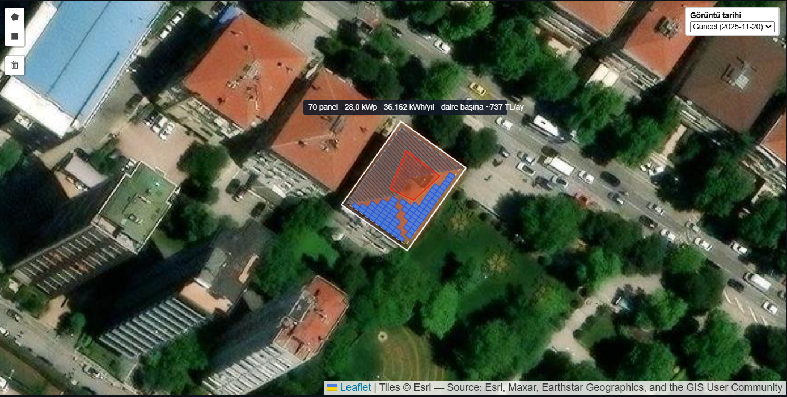

# İstanbul Çatı GES Uygunluk Aracı

**Canlı demo:** https://istanbul-cati-ges.onrender.com
*(Ücretsiz barındırma kullanıldığı için ilk açılış ~30 saniye sürebilir.)*

> **English summary.** A web tool for Istanbul apartment buildings (GreenTech / COP31, Task 3 "Build and Show").
> A resident clicks a building on a map, draws roof obstacles on a satellite view, and gets an explainable rooftop-solar
> assessment: installable capacity (kWp), annual production, CO₂ reduction, cost range, per-flat savings, payback and a
> confidence level. All numbers come from deterministic, unit-tested geometry and physics (PVGIS, building footprints,
> EPDK tariff). AI is used in two supporting roles: a LightGBM model that estimates missing building heights, and a Gemini
> text explainer that is never allowed to introduce a number. Built only from open data. Details below (in Turkish).



*Çatı görünümü: seçilen binanın izi (beyaz), kenar boşluğu (kesikli çizgi), kullanıcının çizdiği engel (kırmızı) ve hesaplanan panel yerleşimi (mavi).*

---

## 1. Projenin amacı

İstanbul'un çatı güneş enerjisi potansiyeli büyük ama neredeyse hiç kullanılmıyor. Asıl engel teknik değil, **bilgi eksikliği**:
bir apartman sakini çatısının uygun olup olmadığını, ne kadar üreteceğini ve kendisine ne kazandıracağını bilmiyor.

Bu araç şu soruya saniyeler içinde, güvenilir ve açıklanabilir bir cevap verir:

> *"Dairelerimiz birlikte tek bir çatı güneş sistemi kurup üretimi eşit paylaşırsa ne kazanırız?"*

Birim **apartman binasıdır**. Bina yöneticisi ya da herhangi bir sakin haritada binaya tıklar; uygulama eldeki tüm veriyi
kullanır ve kullanıcıya en az soruyu sorar. Sahada ölçüm, anket veya özel veri toplama gerekmez; **yalnızca açık veri** kullanılır.

## 2. Nasıl kullanılır

1. **Binayı seçin.** Harita Erenköy / Suadiye / Göztepe bölgesini kapsar (mavi çerçeve). Binaya tıklayın; taban alanı,
   kat sayısı ve yükseklik otomatik gelir.
2. **Daire sayısını kontrol edin.** Kat sayısı ve taban alanından tahmin edilir; farklıysa düzeltin.
3. **İsteğe bağlı bilgileri girin:** çatı yapısı (düz / eğimli / karma / bilmiyorum) ve ortalama aylık daire faturası.
4. **Çatı görünümünde engelleri çizin** (baca, klima, çatı çıkışı vb.). Harita bina çerçevesine sabitlenir; kaydırma yoktur.
   Yüksek binalarda uydu görüntüsünde çatı yana kayık görünebilir; *"Çerçeveyi çatıya hizala"* ile beyaz çerçeve çatının üstüne
   getirilir. Haritanın sağ üstünden iki farklı çekim tarihi (Güncel 2025-11-20 / 2023-12-07) seçilebilir.
5. **Hesapla'ya basın.** Sonuçta şunlar görünür:
   - Bina geneli: kurulabilir güç (kWp), yıllık üretim (kWh), CO₂ azaltımı, toplam kurulum maliyeti aralığı
   - Daire başına: tek seferlik maliyet, yıllık indirim (TL), geri ödeme süresi
   - Haritada hesaplanan panel yerleşimi ve aylık üretim grafiği
   - Güven seviyesi (Yüksek / Orta / Düşük) ve nedenleri
   - Türkçe yapay zekâ açıklaması ve indirilebilir rapor

## 3. Nasıl çalışır?

```
Harita tıklaması ─► Bina izi + kat sayısı/yükseklik (Overture / OSM; eksikse LightGBM tahmini)
                          │
Kullanıcı: engel çizimi, çatı yapısı, fatura (isteğe bağlı)
                          │
              Çatı geometrisi (kenar boşluğu, düz teras / kırma çatı yüzleri)
                          │
        Panel yerleşimi (deterministik arama, gölgelenmesiz sıra aralığı)
                          │
   PVGIS v5.3 (üretim, ışınım, ufuk) ─► kWp, kWh, CO₂, maliyet, EPDK tarife ile tasarruf
                          │
   Güven seviyesi  ──►  Gemini: yalnızca hesaplanmış sonucu Türkçe açıklar (sayı doğrulayıcı ile)
```

**Panel yerleşimi (`core/layout.py`).** Paneller 1,72 × 1,13 m (0,40 kWp) alınır. Bina izinden 1 m kenar boşluğu düşülür,
çizilen engellerin çevresinde 0,5 m boşluk bırakılır. Kod panelleri dikey ve yatay, 4 × 4 farklı kaydırmayla dener
(32 aday ızgara); her panelin 4 köşesi ve merkezi çatının içinde olmalı, engelle kesişmemelidir. En çok panel sığan yerleşim
seçilir. Düz çatıda satırlar doğu-batı yönünde dizilir, paneller güneye bakar ve satır aralığı 21 Aralık öğle güneşinde birbirini
gölgelemeyecek şekilde hesaplanır; eğimli çatıda paneller yüzeye yatık döşenir. **Panelleri hiçbir yapay zekâ modeli yerleştirmez.**

**Tasarruf (`core/cost.py`, `core/calc.py`).** Üretim 12 ayrı aya bölünür ve dairelere eşit paylaştırılır. Fatura girildiyse
EPDK kademeli tarifesine göre (limit üstü kWh önce yüksek kademeden düşülür) aylık net mahsuplaşma yapılır; fatura girilmediyse
"geniş tahmin: kademe bilinmiyor" etiketiyle aralık verilir. Tüketimi aşan fazla üretim 0 TL sayılır (muhafazakâr varsayım).

**Güven seviyesi.** Veri kaynağına ve kullanıcı girdilerine göre Yüksek / Orta / Düşük atanır; neden ve iyileştirme önerisi
her zaman listelenir. Komşu bina gölgesi henüz hesaba katılmadığı için "Yüksek" şu an bilinçli olarak ulaşılamaz bırakılmıştır.

## 4. Yapay zekâ nerede, neden orada?

Karar verdiren sayıları (kWp, TL, geri ödeme) bir dil modelinin üretmesi uydurma riski taşır. Bu yüzden **hesap çekirdeği deterministiktir ve birim testlerle doğrulanır**; yapay zekâ bu çekirdeğin etrafında, her zaman denetlenebilir bir destek rolündedir. Tasarım ilkemiz: **YZ öneri getirir, geometri ve fizik hesaplar, kullanıcı onaylar.**

### Bugün uygulamada çalışan YZ bileşenleri

| Bileşen | Ne yapar | Sınırı |
|---|---|---|
| **LightGBM bina yüksekliği tahmini** | Etiketsiz binalarda yüksekliği tahmin eder. 3.376 yüksekliği bilinen bina, 5 katlı çapraz doğrulama: **MAE 6,78 m** (sabit 15 m varsayımı 13,05 m; komşu medyanı 7,86 m). Etiketli binalarda kat sayısı × 3 m kullanılır. | Model Kaggle'da önceden eğitildi; uygulama yalnızca `height_ml_m` sütununu okur. Tahmin arayüzde "YZ tahmini" olarak etiketlenir. |
| **Gemini metin açıklayıcı** | Hesaplanmış sonuç JSON'unu 3 gerekçe ve öneri ile Türkçe açıklar. | Metindeki her sayı sonuçta bulunmak zorundadır (sayı doğrulayıcı); olmayan alan adları ve gelecek özellik vaatleri filtrelenir; başarısız olursa şablon metne düşer. Hiçbir sayı üretmez, panel yerleştirmez. |

Uydu görüntüsü **hiçbir modele gönderilmez, işlenmez ve saklanmaz**; yalnızca ekranda gösterilir.

### Yol haritası: YZ'yi çekirdeğe yaklaştırmak (planlanan, henüz uygulamada yok)

Bugünkü sürümde engelleri kullanıcı çizer, çünkü Esri görüntüsünün çözünürlüğü (yaklaşık 0,23 m/piksel) ve lisansı bir modelle otomatik tespit için uygun değildir. Daha yüksek çözünürlüklü ve kurumsal lisanslı görüntüyle (İBB / TKGM ortofoto, 10–30 cm) aşağıdaki aşamalar mümkün hale gelir:

1. **Görüntüden otomatik engel tespiti (öneri + onay).** Bir görüntü bölütleme/nesne algılama modeli bacaları, klimaları, çatı çıkışlarını ve teras alanlarını önerir; kullanıcı haritada tek tıkla onaylar ya da düzeltir. Panel yerleşimi yine deterministik kalır, model yalnızca "nerede engel var" sorusuna yardım eder.
2. **Çatı tipi sınıflandırması.** Düz, kırma ve beşik çatıyı görüntüden tahmin ederek bugün kullanıcıya sorduğumuz "Çatı yapısı" bilgisini otomatik doldurmak ve "Bilmiyorum" durumundaki geniş aralığı daraltmak.
3. **Ufuk çizgisi ve komşu bina gölgesi.** Yükseklik tahminiyle (LightGBM) birleşen bina yükseklikleri üzerinden her çatı için ufuk profili çıkarıp gölge kaybını saatlik hesaplamak. Güneş geometrisi fizikle hesaplanır, YZ yalnızca eksik yükseklik verisini tamamlar. Bu aşama güven seviyesini "Yüksek"e çıkarabilen adımdır.
4. **Görüntü hizalama (perspektif düzeltme).** Yüksek binalarda uydu görüntüsündeki kaymayı bina yüksekliği ve çekim açısıyla otomatik düzeltmek; bugünkü elle "Çerçeveyi çatıya hizala" adımının yerini alacak.
5. **Daha iyi tahminler.** Daire sayısı ve tüketim için veriyle eğitilmiş modeller; bugünkü "kat sayısı × taban alanı ÷ 120 m²" formülünün yerine geçecek ve arayüzde yine "YZ tahmini" olarak etiketlenecek.

Her aşamada kural değişmez: **sayıları hesap üretir, YZ yalnızca girdi önerir veya eksik veriyi tamamlar, sonuç açıklanabilir ve kullanıcı tarafından düzeltilebilir kalır.**

## 5. Karşılaştığımız engeller ve çözümlerimiz

| Engel | Çözüm |
|---|---|
| **Çatı engellerini fotoğraftan otomatik bulmak** (ilk plan: kullanıcı fotoğraf yükler, model engelleri bulur) güvenilir değildi ve uydu görüntüsünü bir modele göndermek lisans açısından sorunluydu. | Fotoğraf yükleme ve fotoğraf YZ analizi tamamen kaldırıldı. Engelleri kullanıcı haritada çizer; bu daha güvenilir, açıklanabilir ve lisans açısından temizdir. |
| **Çatıya yakın, net uydu görüntüsü.** Esri World Imagery'nin gerçek çözünürlüğü z19 (~0,23 m/piksel) ile sınırlı; z20+ karoları "veri yok" yer tutucusudur. Google/Bing görüntüleri çizim/dijitalleştirme için lisanslarca engelli. | Görüntü yazılımla yapay olarak büyütülmedi. Harita bina çerçevesine sığdırılıp z19,5'te sabitlendi; iki farklı çekim tarihi seçilebilir. Netleştirme (klasik filtre ve Real-ESRGAN) denendi, sonuç yeterince doğal olmadığı için bilinçli olarak **kaldırıldı**. |
| **Yüksek binalarda çatı görüntüde yana kayık görünür** (perspektif). | "Çerçeveyi çatıya hizala" aracı: oklar, 5 m adımlar, tıklayarak hizalama ve sıfırlama. Hesap her zaman bina izinden yapılır; hizalama yalnızca çizimi kolaylaştırır. |
| **Haritada kaydırma, çizimi bozuyordu** (Streamlit her etkileşimde yeniden çizer). | İkinci harita sabit (kaydırma/yakınlaştırma kapalı); çizimler yeniden çizimlerde korunur; hizalama paneli açık kalır. |
| **Dil modeli sayı uydurabilir.** | Sayılar yalnızca hesaptan gelir; Gemini çıktısı sayı doğrulayıcıdan geçer, olmayan alan adı ve vaatler filtrelenir, hata olursa şablon metin kullanılır. |
| **Çatı yapısı (düz / eğimli) çoğu zaman bilinmiyor.** | Bilinmiyorsa hem düz hem eğimli çatı için **aralık** hesaplanır ve güven seviyesi bir kademe düşer; seçilirse sonuç tek değere iner. |
| **OSM'de birçok binanın yüksekliği yok.** | Önce yükseklik/kat etiketi, yoksa LightGBM tahmini; kaynak her zaman arayüzde etiketlenir. |
| **Mevzuat:** üretim ve tüketim tesisi aynı kişiye ait olmalı; üretim bireysel faturalardan doğrudan düşülemez. | Sistemin ortak alan sayacına bağlandığı varsayımı açıkça belirtilir; tasarrufun aidattan eşit düşülmesi önerilir. Sınırlamalar sonuç sayfasında yazılıdır. |
| **Ücretsiz barındırma uyuyor.** | Düzenli ping ile uyanık tutuluyor (ilk açılış yine de yavaş olabilir). |

## 6. Kaynaklar ve doğrulama

- **Testler:** 600'den fazla birim testi (`python -m pytest`); testler ağa çıkmaz. Fiziksel tutarlılık için İstanbul'un özgül verimi
  PVGIS/pvlib ile karşılaştırılır (~1.100–1.450 kWh/kWp aralığı) ve yükseklik duyarlılığı sınanır.
- **Saha verisi yoktur;** doğrulama sentetik geometri testleri ve fizik tutarlılık kontrolleriyle yapılır. Sonuçlar *tahmindir*,
  gerçek fiyat teklifle ve yerinde keşifle netleşir; çatı statik taşıma kapasitesi bir mühendis tarafından kontrol edilmelidir.

## 7. Sınırlamalar ve sonraki adımlar

- **Komşu bina gölgesi** henüz hesaba katılmıyor; yalnızca arazi (tepe) gölgesi var. Bu yüzden güven seviyesi "Yüksek"e çıkmaz.
- Kapsam şu an **Erenköy / Suadiye / Göztepe** (boylam 29,050–29,100; enlem 40,950–40,990).
- Daha net ve doğru görüntü için **İBB / TKGM ortofoto** (10–30 cm) kurumsal işbirliğiyle entegre edilebilir; bu, engel/çatı
  tespitinde gerçek bir YZ katkısının da önünü açar.
- Sonraki adımlar: komşu bina gölgesi, daha fazla doğrulama binası, PVGIS için yedek kaynak, İstanbul geneline genişleme.

## 8. Yerelde çalıştırma (Windows PowerShell)

```powershell
py -3.11 -m venv .venv
.\.venv\Scripts\Activate.ps1
pip install -r requirements.txt
copy .streamlit\secrets.toml.example .streamlit\secrets.toml   # anahtarı düzenleyin (veya $env:GEMINI_API_KEY)
python -m pytest
streamlit run app.py
```

API anahtarı yalnızca `.streamlit/secrets.toml` veya ortam değişkeninde tutulur; depoda yoktur.
Teknoloji: Python 3.11, Streamlit, Folium/Leaflet (Leaflet Draw), shapely, pyproj, pvlib, pandas, LightGBM (çevrimdışı eğitim), Google Gemini (yalnızca açıklama).

## 9. Veri kaynakları ve lisanslar

- **Bina verisi:** © OpenStreetMap katkıcıları ve Microsoft ML Buildings, ODbL, Overture Maps Foundation üzerinden; etiketsiz bina yükseklikleri
  bu veriyle eğitilmiş LightGBM tahminidir (GlobalBuildingAtlas verisi kullanılmadı).
- **Güneş verisi:** PVGIS v5.3, European Commission JRC
- **Uydu harita karoları (yalnızca gösterim; hiçbir modele gönderilmez, işlenmez veya saklanmaz):** Esri World Imagery —
  "Tiles © Esri — Source: Esri, Maxar, Earthstar Geographics, and the GIS User Community"
- **Işınım katmanı:** Global Solar Atlas (CC BY 4.0)
- **CO₂ faktörü:** ETKB TÜESEF 2021 (0,6345 tCO₂/MWh); **kullanılabilir alan oranı:** Ember; **tarife:** EPDK (AG tek terim mesken, 2026-04-04)

## 10. Lisans

AGPL-3.0 (bkz. `LICENSE`). Depodaki `yolo_service/` klasörü önceki bir denemeden kalmadır ve uygulamanın güncel akışında kullanılmaz;
Ultralytics YOLOE AGPL-3.0 olduğundan depo aynı lisansla açık kalır.

Teknik ayrıntılar için `SPEC.md`, geliştirme kuralları için `AGENTS.md` dosyalarına bakın.
